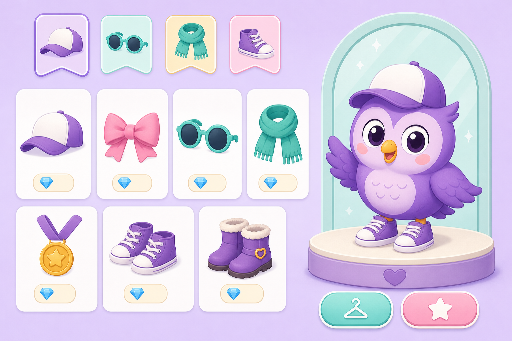

# Примерочная БУКа: вариант реализации магазина

Статус: предложение (после ревью текущей «витрины-на-картинке»). Дата: октябрь 2026.
Задача: товары на картинке должны быть именно товарами магазина, закладки
картинки — выбором раздела, а примерка — видна крупно. Ниже — разбор, лучшие
практики и конкретный вариант.

Концепт-макет предлагаемого экрана: [`shop-fitting-room-concept.png`](shop-fitting-room-concept.png)



---

## 1. Что не так в текущей реализации

| Проблема | Почему так вышло |
| --- | --- |
| Товары-стикеры теряются на пёстрой картинке | Декоративная сцена и товары борются за внимание: низкий контраст, мелкие плашки поверх арта |
| Нарисованные на картинке вещи — просто фон | Картинка-сцена и каталог не связаны: нарисованное не является настоящими товарами с именами и ценами |
| Примерка мелкая | Сову-примерку показываем размером 88px в панели — обувь и мелкие аксессуары не разглядеть |
| Нет выбора раздела | Весь каталог из 12 товаров лежит одной кучей |

Суть ошибки: мы сделали «интерактивную сцену», а нужен «магазин с примеркой» —
товар первичен, декор вторичен.

---

## 2. Что показывают лучшие практики

Изучены avatar/dress-up магазины: Roblox Avatar Editor и каталог, Catalog
Avatar Creator, Avatar Outfit Catalog, Toca Boca Character Creator и Outfit
Designer, Animal Crossing (дизайн/превью).

1. **Единая раскладка «персонаж + товары»**: постоянная крупная примерка
   персонажа с одной стороны, сетка товаров — с другой
   ([Avatar Outfit Catalog](https://www.avataroutfitcatalog.wiki/guide/Avatar-Outfit-Catalog-full-guide),
   [Toca Boca: Character Creator](https://tocaboca.helpshift.com/hc/en/3-toca-boca-world/faq/135-what-type-of-content-is-available-for-purchase-in-toca-boca-world/)).
2. **Try-on ≠ покупка**: любую вещь можно бесплатно «примерить» на персонажа до
   покупки; превью не добавляет вещь в инвентарь
   ([робота Roblox: Try On](https://en.help.roblox.com/hc/en-us/articles/206142306-Understanding-an-item-s-details-page),
   [примеры try-on механик](https://www.avataroutfitcatalog.wiki/guide/Avatar-Outfit-Catalog-how-to-use)).
3. **Категории — вкладки-закладки сверху**: у Toca Boca Shop — 5 вкладок, у
   Roblox — категорийные табы (Clothing → Hair, Face…). Для маленького магазина
   4–6 закладок с иконками — оптимум
   ([Toca Life World Shop](https://toca-life-world.fandom.com/wiki/Shop),
   [категории аксессуаров Roblox](https://www.avataroutfitcatalog.wiki/guide/Avatar-Outfit-Catalog-avatar-tutorial)).
4. **Категории кодируются цветом и иконкой**, чтобы обходиться без чтения
   (Toca Boca: жёлтое — тело, голубое — лицо, красное — одежда)
   ([Toca Character Creator](https://toca-life-world.fandom.com/wiki/Character_Creator)).
5. **Товар — крупная картинка на чистой карточке**; декор не пересекается с
   витриной. Тап-таргеты большие, управление «touch-first», без таймеров
   (гайды Toca: «simple, touch-first controls… no time limits»
   ([Google Play](https://play.google.com/store/apps/details?id=com.tocaboca.tocalifeworld&hl=en)).
6. **Состояния честные и видимые**: цена, «куплено», «надето» — на самой
   карточке; детали товара открываются отдельной карточкой с кнопкой действия
   ([страница товара Roblox](https://en.help.roblox.com/hc/en-us/articles/206142306-Understanding-an-item-s-details-page)).

Вывод: отказываемся от «стикеров на сцене» в пользу схемы
**закладки-категории → крупные карточки-товары → большая живая примерка**,
а картинка остаётся стилем и вывеской, а не витринным фоном.

---

## 3. Вариант реализации: три зоны

```
┌────────────────────────────────────────────────────────────────────┐
│ ←  УГОЛОК БУКа                                      💎 24         │
│ ╭──────────────────────────────────────────────────────────────╮   │
│ │ ✨ вывеска магазина (узкая полоска-картинка, только декор)    │   │
│ ╰──────────────────────────────────────────────────────────────╯   │
│ [🎒 Всё] [🎩 Головные] [👓 Очки] [🧣 Одежда] [👟 Обувь]  ← закладки│
│ ┌───────────────────────────────┐  ┌────────────────────────────┐  │
│ │ КАРТОЧКИ-ТОВАРЫ               │  │  ПРИМЕРКА (крупно)        │  │
│ │ ┌─────────┐ ┌─────────┐      │  │                            │  │
│ │ │  кепка  │ │ бантик  │      │  │      🦉  320 px            │  │
│ │ │   8 💎  │ │   8 💎  │      │  │   большая живая сова       │  │
│ │ └─────────┘ └─────────┘      │  │   с примеряемой вещью      │  │
│ │ ┌─────────┐ ┌─────────┐      │  │        [ 🔍 крупно ]       │  │
│ │ │ очки    │ │ шарфик  │      │  │                            │  │
│ │ │  10 💎  │ │ ✓куплено│      │  │  «Кепка»                  │  │
│ │ └─────────┘ └─────────┘      │  │  Козырёк от солнечных…     │  │
│ └───────────────────────────────┘  │  [ Надеть ] [ Купить 8💎 ] │  │
│                                    └────────────────────────────┘  │
└────────────────────────────────────────────────────────────────────┘
```

### 3.1. Закладки-разделы (как на картинке)

Та же лексика, что нарисована на концепте, — для ребёнка это уже знакомые
«полки» магазина:

| Закладка | Что внутри | Товаров сейчас |
| --- | --- | --- |
| 🎒 Всё | весь каталог | 12 |
| 🎩 Головные уборы | кепка, бантик | 2 |
| 👓 Очки | очки | 1 |
| 🧣 Одежда | шарфик, медаль | 2 |
| 👟 Обувь | все пары | 7 |

- Закладка — чип-кнопка с иконкой и словом (аналог вкладок Toca/Roblox);
  активная — с заливкой и цветом категории (цветовое кодирование из практики
  Toca Boca).
- Это просто фильтр товарного грида: для12 товаров хватает, а когда добавятся
  «Гаджеты / Гараж / Пристань» (шаги 2–3 дорожной карты) — те же закладки
  станут полками коллекции, ничего не надо перестраивать.
- На мобильном закладки прокручиваются в одну строку.

### 3.2. Товары — это и есть картинки товаров

Главное исправление: **витрина — чистая**, каждый товар лежит на своей
крупной карточке:

- карточка 140–170px (на мобильном — 2 в ряд), светлый фон, без декора за
  артом;
- сверху — **арт самого товара** (своё изображение пары кроссовок, кепки,
  очков в стиле концепта; пока артов нет — крупная эмодзи-плитка);
- ниже — имя, флейвор, пилюля цены 💎 и бейдж состояния:
  `✓ Куплено` · `✦ Надето` · `🔒 Пока не хватает`;
- выбранная карточка обводится кольцом.

Декоративная сцена отступает на роль **вывески** — узкая полоска-баннер над
закладками (из текущего концепта сжимается кропом), чисто атмосферная, без
кликабельных точек. Товары больше ничему не проигрывают.

### 3.3. Крупная примерка

Постоянная панель справа (на мобильном — первым экраном над закладками):

- **живая SVG-сова 300–360px** (не картинка — те же слои, что носят вещи во
  всём приложении); тап по любой карточке мгновенно надевает вещь на примерку,
  даже если она не куплена (try-on ≠ покупка — база Roblox-каталога);
- **«🔍 крупно»** — режим крупного плана: сова увеличивается до ~1.8× с
  фокусом на нужную зону (к лапкам для обуви, к лицу для очков); для мелких
  вещей это буквально «увидеть результат примерки в крупном масштабе»;
- под совой — имя, флейвор и редкость выбранной вещи и кнопки:
  `Купить · N 💎` (disabled, пока не хватает) / `Надеть` / `Снять`;
- смена вещи — мягкий fade+scale ~150мс, при надевании — лёгкое ✦ (как в
  наградах);
- панель ничего не решает за ребёнка: примерка ни к чему не обязывает, покупка
  — отдельное нажатие.

### 3.4. Внизу — компактный тизер «Коллекция БУКа»

Вторая картинка (гараж / пристань / гаджеты) остаётся, но уходит вниз узкой
лентой «скоро» без товарной сетки — она про будущие разделы, а не про текущие
товары.

---

## 4. Техническая часть

- **Категории**: у `SHOP_CATALOG` появляется поле `group: 'head' | 'face' |
  'clothes' | 'feet'` (выводится из текущего `wearable`-слота: head→Головные,
  face→Очки, neck+chest→Одежда, feet→Обувь). Закладки — фильтр по `group`.
- **Состояние экрана**: `activeGroup`, `selectedId`, `zoomFocus: null | 'feet'
  | 'face'` — три `useState` в `ShopScreen`, никаких новых хранилищ.
- **Арты товаров**: `public/shop/items/<id>.webp` (12 изображений в стиле
  концепта, по 30–60 КБ, всё ещё офлайн и лёгко); до их появления карточка
  рендерит эмодзи-плитку — переключение одной строкой.
- **Вывеска**: `wardrobe.webp` кропится в баннер 5:1 (или генерация заново),
  без интерактива.
- **Примерка**: существующий `Owl` со слоем обуви/аксессуаров; «крупно» —
  CSS-трансформ на обёртке SVG (scale + translate), без правок в слоях.
- **Тесты**: фильтр закладок, тап по карточке меняет примерку, состояния
  «куплено/надето», режим «крупно», недоступная покупка — disabled.

---

## 5. План шагов

| Шаг | Содержание | Почему в этом порядке | Статус |
| --- | --- | --- | --- |
| 1. Перестройка экрана | три зоны, закладки, карточки-товары (сначала эмодзи-арт), большая примерка + «крупно» | сразу чинит все три замечания, без новых ассетов | ✅ сделано |
| 2. Арты товаров | картинки-товары в стиле концепта на карточки | «товары на картинке» буквально | ✅ 12 из 12 («Ласты» и «Неон» добраны после показа) |
| 3. Вывеска и полировка | баннер-кроп, анимации примерки, ✦ при надевании | атмосфера | ✅ сделано |
| 4. Тизер коллекции | компактная лента «скоро» внизу | не мешает покупкам | ✅ сделано |
| 5. Ревизия по показу | те же арты на Сове, примерка в полный рост, «крупно» без кропа | прямые замечания по итогам показа | ✅ сделано |

Шаг 1 — небольшой и полностью внутри текущего кода; шаги 2–3 — про графику.

---

## 6. Риски

- **Мелкие карточки на телефоне.** Держим минимум две в ряд и тап-таргет
  ≥ 44px; крупная примерка и так показывает вещь детально.
- **Слоты артов на Сове.** Арты-стикеры лежат в общих слотах
  (`src/ui/shopArt.ts`): портрет `BLOB_ART_SLOTS`, полный рост `FULL_ART_SLOTS`.
  Позиции доведены по рендер-мокам; новый арт требует такого же прогона.
- **Закладки с одной «Очкой» выглядят пусто.** Нормально для детского магазина
  (у Toca тоже разные вкладки по размеру), а разделы растут со временем.
- **Арты должны быть в одном стиле.** Генерируем по одному промпту-стилю
  (плоский вектор, пастель), резерв — эмодзи-плитка.

---

## 7. Ревизия по итогам показа (19.10.2026)

Показ «Примерочной» выявил три замечания; арты товаров при этом одобрены:

1. **На Сове — другие арты, «как обман».** Теперь на Сову надеваются те же
   прозрачные WebP-арты, что и на карточках (`public/shop/items/*`), —
   paper-doll-оверлеи поверх SVG-тела. Старые SVG-слои остаются фоллбэком
   для id без арта. Актуально везде, где БУК носит вещи (магазин, дом,
   уроки, парящая сова).
2. **Примерка только на голове делает обувь нелепой.** Добавлена сова
   в полный рост (`DressUpOwl`, viewBox 200×300: голова, тело, крылья, лапки);
   примерка идёт на ней, портретный `Owl` остаётся брендом на других экранах.
3. **Нет выхода из «Крупно» и кадрирование.** Зум теперь — просто крупнее
   весь рост (`fitting-stage-zoom`, без `transform: scale` и кропа), а кнопка
   явно переключается: «🔍 Крупно» ↔ «✕ Обычный размер».

Слоты размещения артов живут в `src/ui/shopArt.ts`; пропорции артов —
1:1, 3:2 и 4:3 (указываются в слотах как `ratio = h/w`).

---

## Итого в одну фразу

Магазин становится «примерочной»: **закладки-разделы** (как нарисовано на
картинке) → **крупные карточки-товары с собственным артом** (товар и есть
картинка) → **большая живая примерка с зумом** (включая обувь), а декоративная
сцена отступает на роль вывески.
