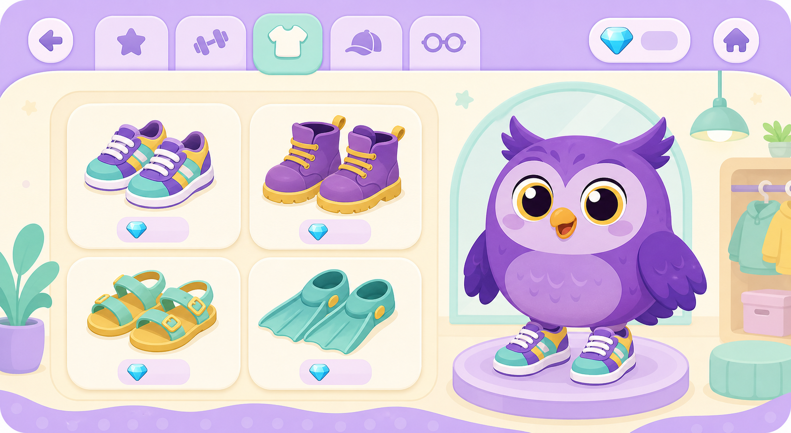
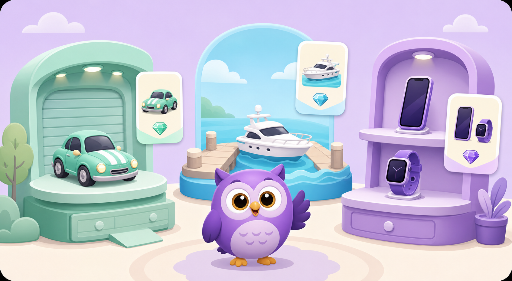

# Новые разделы магазина: исследование и предложения

Статус: черновик предложений (без реализации). Дата: октябрь 2026.
Тема: добавить в «Магазин БУКа» новые разделы с разными видами товаров — обувь,
машины, яхты, телефоны. Ниже: разбор текущего устройства, опыт похожих продуктов,
решение с чего начать, каталог товаров и дизайн-концепции.

---

## 1. Исходная точка: как устроен магазин сейчас

Сегодня «Уголок БУКа» (`src/ui/screens/ShopScreen.tsx`) — это магазин нарядов для
совы БУКа:

- **Аксессуары** (кепка, бантик, очки, шарфик, медаль) — 8–12 💎, надеваются на
  сову (`Owl.tsx` рисует SVG-слои поверх тела).
- **Перекраска** — 1 💎, меняет акцентный цвет совы.
- **Пазл костюма** — фрагменты падают за уроки (1 за урок, 9 фрагментов = костюм).

Экономика кристаллов (только игровые, реальных денег нет и не должно быть):

| Источник | Доход |
| --- | --- |
| Урок завершён | +5 💎 |
| Каждые 5 примеров подряд без ошибки | +1 💎 |
| Ежедневное задание (всего 3 в день) | +3 💎 за каждое |
| Сундук дня (все 3 задания) | +15 💎 |
| Недельный бонус (3 / 5 / 7 активных дней) | +3 / +5 / +8 💎 |

Реальный активный день — примерно **25–45 💎**, спокойный — 15–25 💎. От этой
шкалы и надо отталкиваться в ценах.

Важное свойство проекта: **офлайн PWA**, вся графика — SVG и эмодзи, тяжёлых
картинок в интерфейсе нет. Это ограничивает дизайн «ценностей» плоской
векторной стилистикой и эмодзи-иконками — и это же его сила (быстро, бесплатно,
легко добавлять товары).

---

## 2. Что показывает опыт похожих продуктов

Короткий разбор рынка (Duolingo, Toca Boca, Khan Academy Kids, детские
математические игры):

1. **Магазин — это «чемоданчик с сокровищами», а не витрина скупки.** Duolingo
   продаёт за гемы только игровые бонусы и косметику ([Shop — Duolingo Wiki](https://duolingo.fandom.com/wiki/Shop));
   Toca Boca строит вовлечённость вокруг коллекций и еженедельных подарков, а не
   вокруг давления покупки ([Toca Boca World](https://www.tocaboca.com/toca-boca-world),
   [гайд для родителей](https://screenwiseapp.com/guides/toca-boca-app)).
2. **Для детей 7–12 коллекционирование — сильнейший мотиватор.** Именно этот
   возраст понимает накопление, коллекции и работу на цель
   ([гайд по геймификации в детских приложениях](https://www.lycore.com/blog/educational-kids-apps-gamification/),
   [Game-Ace: Gamification in Education](https://game-ace.com/blog/gamification-in-education/)).
   Наша аудитория (2 класс) — ровно в этой зоне.
3. **Магазин сам по себе может быть математическим заданием.** Цены, копилка,
   сравнение «что выгоднее» — это финансовая грамотность в игре
   ([Kids learning games: what to build](https://stealwhatworks.com/blogs/news/kids-learning-games-to-build)).
   Для приложения про столбик это идеальное соседство.
4. **Строгие рамки безопасности.** У лидеров категории — никакой рекламы,
   покупки только под контролем родителей, у бесплатных эталонов (Khan Academy
   Kids) покупок нет вообще. Общие правила для детей: без таймеров «успей купить»,
   без лутбоксов, без стыда за отсутствие покупок
   ([Khan Academy Kids](https://www.khanacademy.org/kids), [Safe kids apps](https://screenwiseapp.com/guides/best-android-apps-for-kids-safe-and-fun)).

Вывод для нас: наши 4 идеи (обувь, машины, яхты, телефоны) отлично ложатся в
модель «коллекция сокровищ + копилка цели», но по-разному устроены как
интерфейс. Обувь — **носимая** вещь (живёт на сове), машины/яхты/телефоны —
**коллекционные** вещи (живут на полках-сценах). Это главное архитектурное
различие, и оно определяет порядок работ.

---

## 3. Принципы, которые не обсуждаются

1. Только игровые кристаллы. Никаких реальных денег, подписок и рекламы.
2. Никаких таймеров, «распродаж», исчезающих предложений и лутбоксов. Редкость —
   только про внешний вид, никогда — про случайный дроп.
3. Покупка не улучшает результаты учёбы: кристаллы идут только на радость.
4. Дорогую покупку подтверждаем отдельным шагом («Точно купить? Останется N 💎»),
   мелкую — одним нажатием, как сейчас.
5. Прогресс к цели показываем нейтрально и ободряюще; не стыдим за то, что пока
   ничего не куплено.
6. Всё остаётся офлайн и лёгким: иконки — эмодзи и SVG, сцены — плоская
   векторная графика. Родительский экран получает сводку покупок.

---

## 4. С чего начать: рекомендация

**Первый шаг — «Обувь» (раздел «Гардероб БУКа»).** Причины:

1. **Минимум архитектуры.** Обувь — такой же носимый слой, как кепка или шарфик:
   покупка, «Надеть/Снять», SVG-слой на лапках совы. Механика уже проверена на
   аксессуарах, риск почти нулевой.
2. **Мгновенная видимая награда.** Сова в кроссовках видна на всех экранах —
   покупка «работает» сразу, без новой сцены.
3. **Проверка ценовой лестницы.** Обувь среднего ценового диапазона (10–28 💎)
   позволяет понять, как дети копят и тратят, до того как выпускать машины и
   яхты за сотни кристаллов.
4. **Логичное развитие магазина.** «Маленькие радости» → «Гардероб» — понятная
   детям эволюция: у БУКа теперь не только шапки, но и обувь.

**Второй шаг — «Полка гаджетов» (телефоны, часы, калькулятор).** Товары дешёвые
и средние, им не нужна большая сцена — подойдёт карточная витрина. Здесь
впервые включаем механику «коллекции» (куплено X из Y) и «любимую вещь».

**Третий шаг — «Гараж и Пристань» (машины, яхты).** Дорогие «вещи-мечты», ради
них вводим **копилку цели** (см. §6) и полноценный экран коллекции со сценами.
Яхты — верхний ценовой ярус и долгосрочная цель на 1–2 недели занятий.

Альтернатива, если важнее немедленная мотивация: начать сразу с машин и копилки
(«мечта» мотивирует сильнее, чем тапочки). Минусы: нужен новый экран-ценность,
дорогие цены пока не проверены, и первая же версия рискует сломать ощущение
«мелких радостей». Для MVP рекомендую всё же обувь; копилку можно добавить уже
во втором шаге вместе с гаджетами.

---

## 5. Концепция разделов и каталоги

Общее именование для детей (без слова «товары» и «покупки» в лоб):

| Идея пользователя | Название в приложении | Что это | Живёт где |
| --- | --- | --- | --- |
| Обувь | **Гардероб БУКа** | носимые вещи | слой на сове |
| Телефоны | **Полка гаджетов** | коллекция техники | карточная витрина |
| Машины | **Гараж БУКа** | коллекция транспорта | сцена «гараж» |
| Яхты | **Пристань БУКа** | коллекция водного транспорта | сцена «пристань» |

### 5.1. Гардероб БУКа: обувь (стартовый раздел)

Носится на сове, по одной паре за раз (слот «лапки»). Продолжает текущую
секцию аксессуаров — можно объединить в один раздел «Гардероб» с подзаголовками
«Голова и шея» / «Лапки».

| Товар | Иконка | Цена | Редкость | Флейвор |
| --- | --- | --- | --- | --- |
| Кеды «Первый шаг» | 👟 | 10 💎 | обычные | «С ними точно не промахнёшься мимо ответа» |
| Тапочки «Уютные» | 🩴 | 12 💎 | обычные | «Для занятий не вставая с кресла» |
| Кроссовки «Ветерок» | 👟 | 16 💎 | обычные | «Мчатся к новым примерам» |
| Ботинки «Осенний день» | 🥾 | 20 💎 | обычные | «И по лужам, и по разрядам» |
| Сапожки «Снежинка» | 🥿 | 24 💎 | редкие | «Тёплые даже в минус на доске» |
| Ласты «Морская прогулка» | 🤿 | 26 💎 | редкие | «Заплыв до самой пристани» |
| Кроссовки «Неон» | 👟 | 30 💎 | легендарные | «Светятся в темноте и в уроках» |

### 5.2. Полка гаджетов: телефоны и техника

Коллекционные вещи, живут на полке. Первый раздел, где работают «куплено X из Y»
и «любимая вещь». Тематическая связь с математикой — калькулятор и часы.

| Товар | Иконка | Цена | Редкость | Флейвор |
| --- | --- | --- | --- | --- |
| Калькулятор «Умножайка» | 🧮 | 30 💎 | обычные | «Проверяет, но не подсказывает» |
| Смарт-часы «Тик-так» | ⌚ | 42 💎 | обычные | «Время урока — 5 минут, время радости — дольше» |
| Фотоаппарат «Улыбка» | 📷 | 50 💎 | редкие | «Снимает верные ответы» |
| Телефон «Алло» | 📱 | 62 💎 | редкие | «Звонит друзьям по разрядам» |
| Ноутбук «Заметки» | 💻 | 78 💎 | легендарные | «Вся арифметика в одном месте» |

### 5.3. Гараж БУКа: машины

Средний и верхний ценовой ярус, «вещи-мечты» на несколько дней занятий.

| Товар | Иконка | Цена | Редкость | Флейвор |
| --- | --- | --- | --- | --- |
| Самокат «Пружинка» | 🛴 | 48 💎 | обычные | «Катается между рядами примеров» |
| Велосипед «Крутилка» | 🚲 | 75 💎 | обычные | «Колёса крутятся, цифры тоже» |
| Машинка «Жужжалка» | 🚗 | 100 💎 | редкие | «Ж-ж-ж… и правильный ответ готов» |
| Фургон «Поход» | 🚐 | 130 💎 | редкие | «Везёт палатку и все кристаллы» |
| Электромобиль «Молния» | 🏎️ | 165 💎 | легендарные | «Разгоняется до следующего разряда» |

### 5.4. Пристань БУКа: яхты

Верхняя ступень лестницы — копить от недели до двух. Это и есть главная
долгосрочная цель.

| Товар | Иконка | Цена | Редкость | Флейвор |
| --- | --- | --- | --- | --- |
| Лодка «Ромашка» | 🛶 | 170 💎 | обычные | «Греби по волнам сложения» |
| Катер «Чайка» | ⛵ | 230 💎 | редкие | «Чайка садится на мачту за правильный ответ» |
| Яхта «Парус» | 🛥️ | 300 💎 | редкие | «Парус надут ветерком подсказок» |
| Корабль «Открытие» | 🛳️ | 380 💎 | легендарные | «Целое путешествие по трём разрядам» |

---

## 6. Дизайн «ценностей»: как это должно выглядеть

Концепт-визуалы (сгенерированы для ощущения стиля; сжатые версии уже служат
декоративными иллюстрациями в магазине, а сам интерфейс остаётся на SVG и
эмодзи в текущей палитре `--purple / --mint / --gold`):



*Раздел гардероба: сова в кроссовках и карточки обуви с ценами-кристаллами.*



*«Коллекция БУКа»: гараж, пристань и полка гаджетов как три сцены-полки вокруг совы.*

### 6.1. Карточка товара

Единая анатомия для всех разделов (соответствует текущему `accessory-card`,
только добавляются флейвор и редкость):

```
┌──────────────────────────┐
│      ╭──────────╮        │  плитка-иконка 59×59, скруглённая,
│      │   👟     │        │  фон — пастельный тон категории
│      ╰──────────╯        │
│   Кроссовки «Ветерок»    │
│   «мчатся к новым        │   флейвор, мелкий шрифт
│    примерам»             │
│   ✦ редкие               │   бейдж редкости
│   16 💎   [ Купить ]     │  или ✓ Куплено · [ Надеть ] · 🎯 Цель
└──────────────────────────┘
```

- **Иконка-плитка**: эмодзи на мягком фоне (как сейчас `accessory-picture`).
  Категорийные тона: гардероб — сиреневый `#f5f2ff`, гаджеты — мятный `#e6f5ef`,
  гараж — тёплый `#fdf1e3`, пристань — аква `#e3f4fb`.
- **Редкость** — только рамка и бейдж: обычные (мятная рамка), редкие
  (фиолетовая + ✦), легендарные (золотая + ✦✦ и мягкое свечение). Никаких
  случайных наборов — редкость известна заранее.
- **Состояния карточки**: `Купить` (цена, disabled если мало 💎) → `Куплено` →
  для носимых `Надеть/Снять`, для коллекционных `🎯 Цель` (поставить в копилку)
  и `Любимая` (показывать на полке первой).

### 6.2. Как вещи «живут» в приложении

- **Обувь** — SVG-слой на лапках совы (по аналогии со слоями кепки/шарфика).
  Носим слотом «лапки»: одна пара за раз. Сова с новой обувью видна везде —
  на главной, в уроке, в магазине.
- **Гаджеты** — «Полка гаджетов»: горизонтальная полка-карточка на экране
  коллекции; купленные вещи стоят на полке, некупленные — силуэты с ценой.
- **Машины и яхты** — сцены «Гараж» и «Пристань»: широкие карточки-панорамы
  (как `shop-hero-card`), где купленная машина стоит в гараже рядом с совой,
  а яхта — у причала. Выбранная «любимая вещь» попадает в шапку экрана
  коллекции вместе с совой.
- **Покупка** — короткий момент радости: звук и вибрация из
  `src/platform/feedback.ts`, лёгкий наклон совы, россыпь ✦ (как уже делается с
  наградами). Без полноэкранной анимации — приложение про учёбу.

### 6.3. Копилка мечты (механика-склейка для дорогих вещей)

Ребёнок отмечает товар кнопкой `🎯 Цель`. На главном экране и в магазине —
прогресс-кольцо: «До яхты „Парус“: 120 из 300 💎». Когда накоплено —
ободряющая карточка «Мечта готова!» (без давления). Это и есть финансовая
грамотность в контексте приложения: копить, сравнивать цены, выбирать цель.

### 6.4. Экран магазина целиком

Остаётся одна страница «Магазин БУКа», но с чипами-категориями сверху:
`Всё · Гардероб · Гаджеты · Гараж · Пристань` (фильтр секций, не отдельные
экраны — так проще и привычнее). В шапке — как сейчас счётчик 💎 и пазл
костюма. Внизу — «Сокровищница»: сводка «Собрано 12 из 27» со ссылкой на
коллекцию.

> **Обновление.** Шаг 1 реализован иначе, чем карточная сетка выше: весь
> каталог выложен на интерактивную витрину-картинку (`.shop-scene`) — вещи
> лежат точками прямо на сцене, по нажатию открывается панель с примеркой на
> сове, флейвором, редкостью и кнопкой «Купить / Надеть». Вторая картинка —
> интерактивный тизер «Коллекции БУКа» с точками «скоро» (гараж, пристань,
> гаджеты, копилка мечты). Чипы-категории понадобятся, когда разделов станет
> больше одного.
>
> **Ревью.** «Точки на сцене» себя не оправдали: товары теряются на фоне
> картинки. Разработан новый вариант — **«Примерочная БУКа»**: закладки-разделы
> с картинки, крупные карточки-товары и большая живая примерка с зумом. Подробно:
> [`docs/shop-fitting-room.md`](shop-fitting-room.md).

---

## 7. Экономика: сколько копить

При активном дне ≈ 30 💎 (см. §1):

| Ярус | Примеры | Цена | Сколько копить | Ощущение |
| --- | --- | --- | --- | --- |
| Мелкая радость | аксессуары, кеды, тапочки | 8–16 💎 | полдня | «сразу хочу и могу» |
| Средняя вещь | обувь, часы, калькулятор | 16–50 💎 | 1–2 дня | «надо немного подождать» |
| Крупная покупка | телефон, ноутбук, самокат, велосипед | 50–165 💎 | 2–6 дней | «цель на неделю» |
| Мечта | машина, яхта, корабль | 165–380 💎 | 1–2 недели | «главная цель месяца» |

Правила поддержания баланса:

- Первый товар нового раздела всегда дешёвый (10–30 💎), чтобы «дверь» была
  открыта сразу.
- Между ярусами — плавная лестница, без провалов в 2–3 раза.
- Если данных о покупках покажут, что яхты не берут, цены снижаем мягко
  (локально, без обнуления уже купленного).
- Заряд кристаллов не меняем: магазин не должен подталкивать «фармить» вместо
  занятий. Идеальный ритм: 1–2 урока в день и стабильное движение к цели.

---

## 8. Техническая часть (для будущей реализации)

Модель данных (`src/state/profile.ts`):

```ts
export type ShopCategory = 'accessories' | 'shoes' | 'gadgets' | 'transport' | 'boats'

export interface ShopItem {
  id: string
  category: ShopCategory
  name: string
  flavor: string        // короткая шутка-подпись
  icon: string          // эмодзи
  price: number
  rarity: 'common' | 'rare' | 'legendary'
  wearable?: 'head' | 'face' | 'neck' | 'chest' | 'feet'  // слот на сове
  scene?: 'shelf' | 'garage' | 'pier'                      // где стоит витрина
}

export const SHOP_CATALOG: readonly ShopItem[] = [ /* все разделы одним списком */
  // ACCESSORY_CATALOG переезжает сюда со слотами head/face/neck/chest
]
```

Изменения в профиле (`RewardData`):

- в MVP (шаги 0–1) покупки хранятся в существующих массивах
  `accessoriesOwned` / `accessoriesEquipped` — это просто id строками, поэтому
  старые профили и бэкапы работают без миграции;
- на шаге 2 добавим `favoriteItemId: string | null` («любимая вещь»),
  `goalItemId: string | null` (цель копилки) и, если понадобится для
  коллекционных вещей, `itemsOwned: string[]`;
- `isChildProfile()` принимает старые профили (новые поля опциональны), а
  `backup.ts` сохраняет единый формат.

Интерфейс:

- `Owl.tsx` — новый слой `feet` (обувь), слот «одна пара за раз»;
- `ShopScreen.tsx` — чипы-категории, секции-каталоги из `SHOP_CATALOG`,
  карточка с флейвором и редкостью, подтверждение покупки для цен > 80 💎;
- новый экран `CollectionScreen.tsx` («Сокровищница») с полкой, гаражом и
  пристанью — можно отложить до третьего шага;
- `store.ts` — обобщить `buyAccessory` до `buyItem`, добавить `setGoalItem`,
  `setFavoriteItem`, не сломав существующие вызовы;
- тесты: сэмплы каталога в `content:check` (уникальность id, цены > 0, флейвор
  непустой), smoke-тест покупки обуви и надевания, валидация миграции профиля.

---

## 9. Дорожная карта

| Шаг | Содержание | Проверка результата | Статус |
| --- | --- | --- | --- |
| 0. Основа | `SHOP_CATALOG`, типы, миграция профиля, бэкап-совместимость | `npm run pickup`, `audit:storage` зелёные | ✅ сделано |
| 1. MVP: Гардероб | 7 пар обуви, слой `feet` на сове, секция в магазине, покупка/надеть | ребёнок видит сову в кроссовках на всех экранах | ✅ сделано |
| 2. Гаджеты + копилка | «Полка гаджетов», механики «цель» и «любимая вещь», кольцо прогресса на главной | видно «до ноутбука 40 из 78 💎» | в планах |
| 3. Гараж и Пристань | машины и яхты, экран «Сокровищница» со сценами, подтверждение дорогих покупок | яхта — видимая долгосрочная цель | в планах |
| 4. Полировка | редкость и свечение, анимация покупки, сводка покупок в родительском разделе | родитель видит, что куплено | в планах |

---

## 10. Риски и как их избежать

- **«Магазин перетянет внимание с учёбы».** Держим правило: новые вещи не дают
  преимуществ в уроках, а копилка напоминает о цели мягко, без пушей.
- **Непосильные цены обескураживают.** Лестница ярусов (§7) + всегда дешёвый
  «вход» в раздел + копилка с прогрессом.
- **Слом старых бэкапов.** Миграция добавляет поля, не удаляя старые;
  `isChildProfile()` принимает оба формата; `audit:storage` прогоняем на обоих.
- **Тяжёлая графика.** Интерфейс — на эмодзи и SVG; концепты из этой статьи
  вшиты в магазин только как декоративные иллюстрации в сжатом WebP (~60 КБ),
  чтобы офлайн-кэш оставался лёгким.
- **Реалистичность «ценностей».** Яхты и электромобили — сознательно
  сказочная «мечта» в мире БУКа (как сундук с кристаллами), а не поощрение
  потребления. Флейворы и сцены поддерживают сказочный, а не рекламный тон.

---

## Итого в одну фразу

Начинаем с **«Гардероба БУКа» (обувь)** — это дешёвый и видимый MVP; затем
**«Полка гаджетов» (телефоны)** с копилкой цели; и только потом **«Гараж» и
«Пристань» (машины, яхты)** как дорогие «вещи-мечты» с экраном коллекции —
по единой карточной системе с редкостью, флейворами и категорийными тонами.
